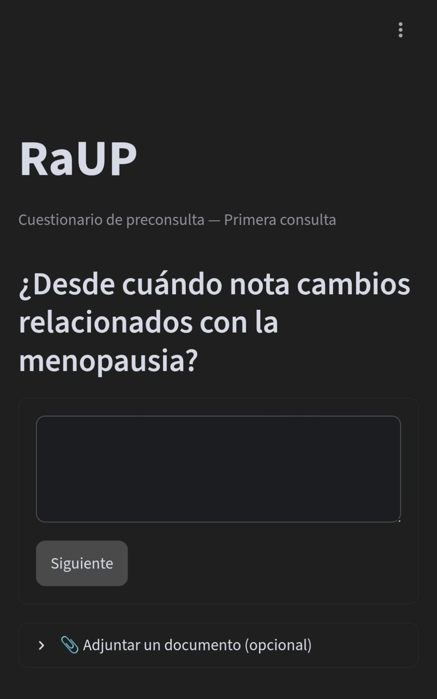
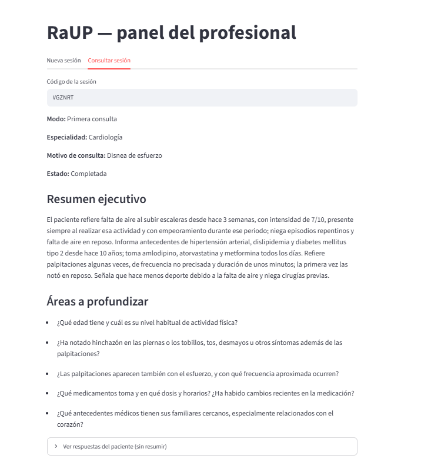
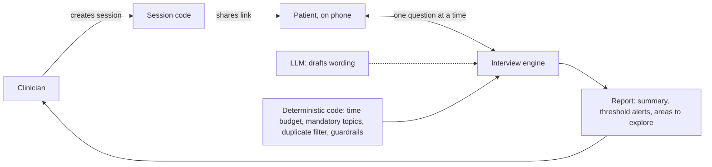

# RaUP

**AI-guided pre-visit anamnesis for clinicians. My Master's thesis in AI for Healthcare.**

**Demo:** available on request (synthetic data only)

The pilot was run in Spain, so the current interface is in Spanish. An English version is available on request.

## The problem

In a one-on-one consultation, the clinician spends the first minutes of the visit collecting basic history: what is going on, since when, medication, past conditions. That is time not spent on the patient.

## How it works

1. **Clinician:** creates a session (first visit or follow-up, plus the consultation reason) and shares a code with the patient.
2. **Patient:** answers a short adaptive interview on their phone before the visit, one question at a time.
3. **Clinician:** receives a structured report: an executive summary of what the patient reported, threshold alerts based on validated screening tools (MUST, SCOFF), and areas to explore further.

## Design principle

The LLM only drafts the wording. Everything safety-critical is deterministic code:

- **Time budget:** a hard cutoff, shorter for a follow-up than for a first visit.
- **Mandatory topics:** medication, medical history and onset cannot be skipped, and a bare "yes" is always followed up.
- **Duplicate filter:** a repeated question never reaches the patient.
- **Guardrails:** diagnostic, interpretive or prescriptive language is blocked before anything is shown.
- **Alert thresholds:** explicit cutoffs from screening instruments, never the model's judgment.

## Tech stack

- **App:** Python, Streamlit
- **Data:** Supabase (EU, Frankfurt)
- **LLM:** OpenAI API (GPT-6 Luna) behind a model-agnostic interface; MedGemma 4B evaluated as an alternative

## Evaluation

Automatic comparison with simulated patients, 9 sessions per model:

| | GPT-6 Luna | MedGemma 4B |
|---|---|---|
| Repeated questions proposed, per session | 0.3 | 12.9 |
| Key facts kept in the report | 85% | 68% |
| Cold start | none (2 s) | ~240 s |

## Pilot (October 2026)

5 participants: 1 practising dietitian and 4 final-year medicine and nursing students.

| | Score |
|---|---|
| Summary fidelity | 5.0 / 5 |
| Felt safe | 5.0 / 5 |
| Ease of use | 4.8 / 5 |

No message was perceived as diagnostic.

**Key finding:** the practising dietitian asked for more depth on lifestyle habits than on symptoms. This drives the roadmap.

## Regulatory approach

- Designed as **MDR Class I**: no diagnosis, no treatment advice. The report only summarizes what the patient reported.
- **EU AI Act** transparency.
- **GDPR**-aware.

## Roadmap

- FHIR / EHR integration
- Habit-focused, clinician-configurable interviews
- Long term: **"Radar for Unhealthy Patterns"**

## Status

The source code is private. It is available on request for academic or professional evaluation.

## Author

**David Moreno Ordóñez**, dietitian and MSc in AI for Healthcare.

[GitHub](https://github.com/davimorord) · [Portfolio](https://davimorord.github.io/portfolio) · [LinkedIn](https://www.linkedin.com/in/davimorord)

## License

All rights reserved. See [LICENSE](LICENSE).
